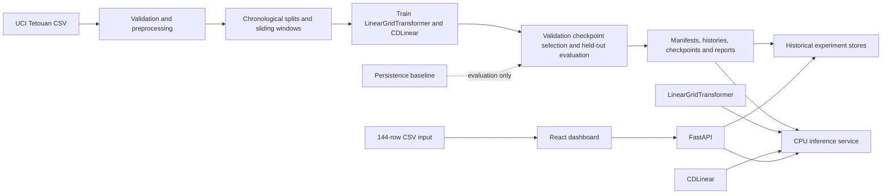

# LinearGridTransformer

A multi-zone electricity forecasting system built around the UCI **Power Consumption of Tetouan City** dataset. The project compares a Taylor-feature linear-attention forecaster with a compact direct linear baseline, evaluates both across multiple seeds, and exposes saved forecasts and experiment history through a FastAPI service and React dashboard.

The main engineering result is not that the more complex model won: **CDLinear was selected as the operational forecaster because it performed better in the recorded comparison.** The Transformer remains available as an experimental alternative. The evaluation also has an important limitation: held-out test metrics informed that model-family selection, so the comparison is subject to test-selection bias.

> **Deployment status:** the repository contains a Render Blueprint and container configuration, but no live public deployment has been confirmed. Demo URL: _not yet available_.

## What is included

- Multi-output forecasting for three Tetouan consumption zones.
- `LinearGridTransformer`, using a second-degree Taylor feature map and associative linear attention.
- `CDLinear`, a direct flatten-and-linear-projection baseline.
- Persistence as a non-trained evaluation baseline.
- Three-seed training histories and per-zone and per-horizon evaluation reports.
- A FastAPI backend for historical experiment data and CPU inference.
- A React dashboard with five sections and a 144-row CSV forecast workflow.
- A Docker image and Render Blueprint for deployment; a local Docker Compose setup is also present in the working tree.
- Optional local MLflow experiment tracking. MLflow is not required by the API or included as a deployed service.

## Forecasting problem and dataset

The source is the [UCI Power Consumption of Tetouan City dataset](https://archive.ics.uci.edu/dataset/849/power+consumption+of+tetouan+city), cited as Salam and El Hibaoui (2018), DOI [10.24432/C5B034](https://doi.org/10.24432/C5B034). The processed metadata records 52,416 observations at ten-minute cadence, from 2017-01-01 00:00 through 2017-12-30 23:50. It records no missing values or duplicate timestamps, but December 31 is absent; no observations were added for that day.

The prediction contract is:

- **Input:** 144 historical observations (24 hours), eight channels, shape `[B, 144, 8]`.
- **Output:** six forecast steps (one hour), three target channels, shape `[B, 6, 3]`.
- **Sampling:** ten minutes; forecast leads are +10, +20, +30, +40, +50 and +60 minutes.

Input channels are ordered as follows:

1. `zone_1_power_consumption` — Zone 1 Power Consumption
2. `zone_2_power_consumption` — Zone 2 Power Consumption
3. `zone_3_power_consumption` — Zone 3 Power Consumption
4. `temperature` — Temperature
5. `humidity` — Humidity
6. `wind_speed` — Wind Speed
7. `general_diffuse_flows` — General diffuse flows
8. `diffuse_flows` — Diffuse flows

The output channels are `zone_1_power_consumption`, `zone_2_power_consumption` and `zone_3_power_consumption`, in that order. The inference CSV requires these canonical identifiers as column headers; an optional `timestamp` or `DateTime` column may also be present. The ETL maps them to the source headers, which include doubled spaces in the Zone 2 and Zone 3 names. Weather/context inputs are historical only; future weather values are not supplied to the models. The source does not document measurement units or timezone. Results therefore remain in **original dataset numeric values**, without a kW/kWh or timezone claim.

The split is chronological by row count: train `[0, 36691)`, validation `[36691, 44553)`, and test `[44553, 52416)`, corresponding to 70/15/15 percent using floor boundaries. The loader allows validation and test windows to use earlier rows as input context, while every target window remains entirely within its assigned partition. This gives 36,542 train windows, 7,857 validation windows and 7,858 test windows.

Feature and target z-score statistics use training rows only, with population standard deviation (`ddof=0`). The saved metadata stores those values; predictions and targets are inverse-transformed with the three training target means and standard deviations before reporting errors. The processed arrays preserve source values and timestamps separately from the normalization metadata.

## System architecture



The preprocessing module validates the source schema, timestamp cadence and data quality, then saves raw feature/target arrays and train-only normalization metadata. The split-aware dataset loader creates windows without imputing or fabricating records. The deployment repository includes the saved manifests, histories, best-validation checkpoints, and metric/prediction artifacts. The full Tetouan training entry point and raw CSV are not part of the deployment commit; the run configuration and results are recorded in the artifacts.

FastAPI loads and caches the selected inference checkpoints and reads historical metadata from experiment stores. It checks artifact consistency during startup, validates forecast input order and dimensions, applies the saved training normalization, and inverse-transforms output predictions. The React app consumes the same API for historical pages and CSV forecasts. Persistence is used only in saved evaluation; it is not listed as a forecastable API model.

## Models and experimental method

### LinearGridTransformer

The model projects the eight input channels to a 64-dimensional representation, applies a single encoder block with four linear-attention heads (16 dimensions per head), residual and feed-forward paths, then maps the encoded sequence to forecast outputs. The attention module uses a second-degree Taylor feature map and associative key/value contractions, avoiding construction of a sequence-length-by-sequence-length attention matrix. A forecasting head uses the final six encoded positions and projects from eight encoder output channels to three target channels.

### CDLinear

CDLinear flattens the `[144, 8]` input window into 1,152 values and applies one learned linear projection to 18 outputs, reshaped to `[6, 3]`. It has no attention or nonlinear decoder. This simpler mapping was substantially faster in earlier CPU feasibility checks and, in the saved three-seed comparison, achieved lower reported errors than the Transformer.

### Training and checkpoint selection

The `extended_training_v2` run trained both models for 50 epochs with seeds 42, 123 and 2026. The saved manifests record batch size 32, AdamW, learning rate 0.001, weight decay 0.01, MSE loss and gradient clipping at 1.0. The Transformer configuration records `d_model=64`, four heads, `ffn_dim=256` and dropout 0.1. Each model's checkpoint was selected independently by lowest **validation loss** within that seed's training run. The selected operational CDLinear inference checkpoint is the seed-2026 checkpoint, chosen from the three CDLinear checkpoints by validation loss.

Validation checkpoint selection and model-family selection are different decisions. The former uses validation loss. The recorded model-family selection compares three-seed mean held-out **test** metrics and marks CDLinear as selected. That test-informed choice introduces selection bias. The test metrics below must not be read as an unbiased final generalization estimate. Three seeds provide a reproducibility comparison, not evidence of statistical significance.

Evaluation includes MAE and RMSE across the three zones, per-zone results, and per-horizon results for each of the six ten-minute leads. Persistence repeats the final observed zone value across all six forecast steps. Errors are inverse-normalized to original numeric values before calculation; physical units remain undocumented.

## Recorded results

The following values come from [`evaluation_report.json`](runtime-artifacts/results/tetouan/extended_training_v2/evaluation_test_v1/evaluation_report.json), generated for 7,858 held-out chronological test windows. Model entries show the mean and standard deviation across the three seeds. Persistence is a single deterministic baseline, so it has no across-seed standard deviation.

| Model | Test MAE, mean ± SD | Test RMSE, mean ± SD |
|---|---:|---:|
| **CDLinear (selected)** | **525.10 ± 52.13** | **713.74 ± 44.17** |
| LinearGridTransformer (experimental alternative) | 1,904.08 ± 241.17 | 2,386.88 ± 269.79 |
| Persistence (evaluation baseline) | 881.21 | 1,424.05 |

MAE pooled over all samples, horizons and zones equals the arithmetic mean of per-zone MAE here because each zone has the same number of evaluated values. It is not independent evidence from macro-zone MAE. RMSE is pooled across all values and is distinct from the macro-average of zone RMSE.

The mean per-zone results below are also averaged across the three seeds (original dataset numeric values):

| Model | Zone | MAE mean ± SD | RMSE mean ± SD |
|---|---|---:|---:|
| CDLinear | Zone 1 | 583.32 ± 22.67 | 769.19 ± 23.20 |
| CDLinear | Zone 2 | 492.54 ± 44.03 | 679.11 ± 45.64 |
| CDLinear | Zone 3 | 499.44 ± 70.73 | 687.87 ± 59.51 |
| LinearGridTransformer | Zone 1 | 2,044.64 ± 331.93 | 2,534.27 ± 364.80 |
| LinearGridTransformer | Zone 2 | 1,664.72 ± 46.73 | 2,192.09 ± 36.88 |
| LinearGridTransformer | Zone 3 | 2,002.87 ± 224.27 | 2,409.86 ± 259.72 |

The evidence supports selecting CDLinear for this application: its mean test MAE and RMSE are below the Transformer and persistence values in this saved comparison. The Transformer remains useful as a tested architectural alternative, but it did not win on these recorded metrics. Because the held-out comparison influenced this choice, the result needs confirmation on a fresh untouched period or through a pre-specified rolling-origin/nested evaluation.

## Dashboard and forecast workflow

The React application has five sections:

- **Overview:** dataset, experiment and model-comparison summary.
- **Forecast Explorer:** upload a CSV containing exactly 144 rows and the eight canonical feature columns in order; optionally include one `timestamp` or `DateTime` column. The UI validates values and requests either one model or a comparison from the backend.
- **Model Laboratory:** saved training and validation histories, model configuration, per-zone evaluation and horizon-wise metric views.
- **Dataset Explorer:** dataset provenance, date coverage, cadence, channel definitions, split information, normalization and known uncertainties.
- **Experiment Details:** saved run configuration, environment, best-validation records and artifact availability.

The CSV is historical input only. A successful forecast comes from a backend response and contains six forecast steps and three ordered zone values per step. Units remain identified as undocumented.

No genuine application screenshots are included in the repository. Recommended screenshots to capture after a live demo is available: Overview, a completed Forecast Explorer comparison, Model Laboratory horizon/zone analysis, and Dataset Explorer provenance.

## API reference

The current API exposes:

| Method and path | Purpose |
|---|---|
| `GET /health` | Readiness and service availability. |
| `GET /api/v1/models` | Forecastable model names, dimensions, configuration and selected/available status. |
| `GET /api/v1/dataset` | Dataset provenance, features, targets, split, windows and normalization metadata. |
| `GET /api/v1/experiments/{experiment_id}` | Experiment configuration, provenance, model roles and safe artifact references. |
| `GET /api/v1/experiments/{experiment_id}/history` | Saved epoch histories and, where available, per-seed histories. |
| `GET /api/v1/experiments/{experiment_id}/metrics` | Saved overall, per-zone and horizon-wise evaluation metrics. |
| `POST /api/v1/forecasts/{model_name}` | Forecast with `LinearGridTransformer` or `CDLinear`. |
| `POST /api/v1/forecasts/compare` | Run both forecastable models against one input. |

Forecast request JSON has `feature_names` (the exact eight canonical identifiers above), `observations` (144 arrays of eight finite numbers), and optional `timestamps` (144 timezone-naive timestamp strings in chronological ten-minute cadence). The response reports `[144, 8]` input dimensions, `[6, 3]` output dimensions, ordered target zone names, and six `forecast_steps` with `horizon_step`, `minutes_ahead` and three `values`. Comparison returns the same six-step structure under each model name. Error responses are sanitized and do not return submitted observations or local filesystem paths.

The supported experiment IDs are `extended_training_v2` and `tetouan_t4_20261101_v1`. Persistence is deliberately not a forecast API model.

## Run locally

### Docker Compose (recommended)

Requirements: Docker Engine/Desktop with Docker Compose v2. The checked-in runtime bundle is mounted read-only by default.

```bash
docker compose config
docker compose build
docker compose up -d
```

Open the dashboard at [http://localhost:8080](http://localhost:8080); readiness is proxied at [http://localhost:8080/health](http://localhost:8080/health). The local setup serves the frontend through Nginx, which proxies API and health requests to the backend. To inspect logs and stop the services:

```bash
docker compose logs -f backend frontend
docker compose down
```

The local working tree also has a `compose.yaml` and `docs/DOCKER.md` with artifact-bundle details. Those two files are not included in the current deployment commit, so the Compose command applies to that working tree rather than a fresh clone of the GitHub deployment branch.

### Native development

The API runtime is pinned in `requirements-api.txt` for Python 3.11. The frontend build uses Node 22.12.0 and pnpm 10.34.3 as declared by the deployment configuration.

In one terminal, install API dependencies in an isolated environment and point the API to the bundled artifacts:

```bash
python3.11 -m venv .venv
source .venv/bin/activate
python -m pip install -r requirements-api.txt
export TETOUAN_RUN_NAME=tetouan_t4_20261101_v1
export TETOUAN_ARTIFACT_DIR="$PWD/runtime-artifacts/data/processed/tetouan"
export TETOUAN_EXPERIMENT_DIR="$PWD/runtime-artifacts/results/tetouan/tetouan_t4_20261101_v1"
export TETOUAN_CHECKPOINT_DIR="$PWD/runtime-artifacts/checkpoints/tetouan"
export TETOUAN_LATEST_EXPERIMENT_ID=extended_training_v2
export TETOUAN_LATEST_EXPERIMENT_DIR="$PWD/runtime-artifacts/results/tetouan/extended_training_v2"
export TETOUAN_LATEST_CHECKPOINT_DIR="$PWD/runtime-artifacts/checkpoints/tetouan/extended_training_v2"
export TETOUAN_LATEST_EVALUATION_DIR="$PWD/runtime-artifacts/results/tetouan/extended_training_v2/evaluation_test_v1"
export TETOUAN_DEVICE=cpu
export API_CORS_ORIGINS=http://localhost:8443,http://127.0.0.1:8443
python -m uvicorn src.api.main:app --host 127.0.0.1 --port 8000
```

In a second terminal, install the frontend dependencies from its frozen lockfile and start Vite:

```bash
cd frontend
npm install --global pnpm@10.34.3
pnpm install --frozen-lockfile
VITE_API_BASE_URL=http://127.0.0.1:8000 pnpm dev -- --host 127.0.0.1
```

Vite serves the development frontend on port 8443. The provided API setup explicitly selects CPU with `TETOUAN_DEVICE`; without that override, inference selects an available accelerator and falls back to CPU. The API also accepts path overrides for runtime artifacts and CORS origins through the variables in `src/api/config.py`.

### Research and reproducibility

The saved manifests record the dataset fingerprint, split and normalization contract, model configurations, seeds, optimizer settings, environment and best validation records. Histories and evaluation reports are included for inspection. Raw CSV data, the Colab notebook and the complete Tetouan training entry point are not part of the deployment commit, so this deployment-focused snapshot does not provide a clean-room retraining command. Held-out evaluation should be used only after selecting checkpoints with validation data; future model-family selection should not reuse the test results shown above.

## Deployment

`render.yaml` defines a free Docker Web Service for FastAPI and a free Static Site for the React build. The intended source is this GitHub repository on `main`. The backend image includes the curated `runtime-artifacts/` bundle; Render does not need the raw dataset or local MLflow store to serve the app. The frontend receives the backend public URL through `VITE_API_BASE_URL`, and the backend CORS origin is configured from the frontend public URL. Automatic deployment is disabled in the Blueprint configuration.

The configuration is prepared for Render, but this README does not claim that Render is connected or that the application is live. Add the public demo URL here only after deployment has been verified.

Free services can have cold starts after idle periods, and their local filesystem is ephemeral. The application packages its read-only inference and history artifacts with the backend image and does not depend on a persistent disk or MLflow at runtime. These configuration facts are not production reliability or availability guarantees.

## Repository map

```text
LinearGridTransformer/
├── src/
│   ├── api/                 # FastAPI routes, schemas and configuration
│   ├── data/                # Tetouan preprocessing, windows and experiment stores
│   ├── inference/           # Checkpoint loading and forecast service
│   ├── models/              # Linear attention, Taylor map and CDLinear
│   └── training/            # Model wrapper and checkpoint evaluation helper
├── frontend/                # React/Vite application and API client
├── runtime-artifacts/       # Processed metadata, checkpoints, histories and reports
├── Dockerfile               # CPU FastAPI image
├── requirements-api.txt     # Pinned API runtime dependencies
├── render.yaml              # Render Web Service and Static Site Blueprint
└── test_attention.py        # Encoder and linear-attention implementation
```

The local working tree additionally contains `compose.yaml`, `docs/DOCKER.md`, and research-only files that are not part of the current GitHub deployment commit. The repository also retains earlier model and data code used by research workflows. The active deployed application uses the Tetouan runtime bundle and the inference/API path described above.

## Limitations and next research steps

- **Test-selection bias:** the three-seed held-out comparison informed which model family is selected. It is not an unbiased final estimate of generalization.
- **Three seeds only:** these runs characterize variation across a small set of seeds; they do not establish statistical significance.
- **Single-city scope:** results are specific to the Tetouan dataset and the recorded feature, split and training choices.
- **No rolling-origin study:** evaluate across multiple forecast origins or a nested protocol with model selection isolated from final evaluation.
- **Fresh untouched evaluation:** confirm the selected model on a new future period or another independent dataset before making broader performance claims.
- **Unknown units and timezone:** source metadata does not document either; avoid physical-unit interpretation or timezone-specific claims.
- **Runtime constraints:** the service is CPU-configured for a free-tier deployment target. Cold starts and inference latency may limit interactive use; no production reliability claim is made.
- **Architecture comparison:** the current result favors the simpler baseline. Any Transformer changes should be tested under a pre-specified protocol and compared against the same baselines.

## Acknowledgements and references

- Salam, A. & El Hibaoui, A. (2018). [Power Consumption of Tetouan City](https://archive.ics.uci.edu/dataset/849/power+consumption+of+tetouan+city). UCI Machine Learning Repository. DOI: [10.24432/C5B034](https://doi.org/10.24432/C5B034). The processed metadata records CC BY 4.0 attribution.
- Source repository: [sriram615/LinearGridTransformer](https://github.com/sriram615/LinearGridTransformer).
